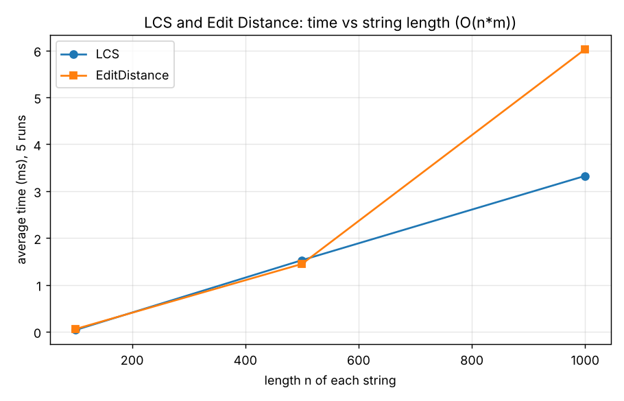
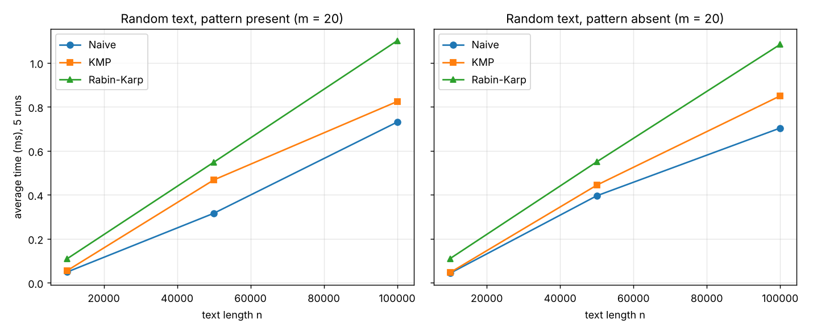
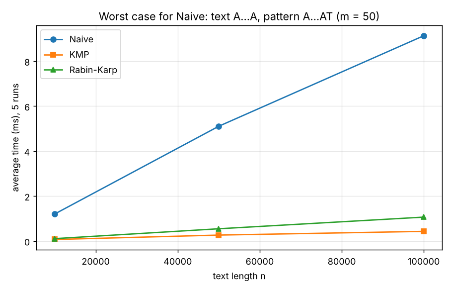
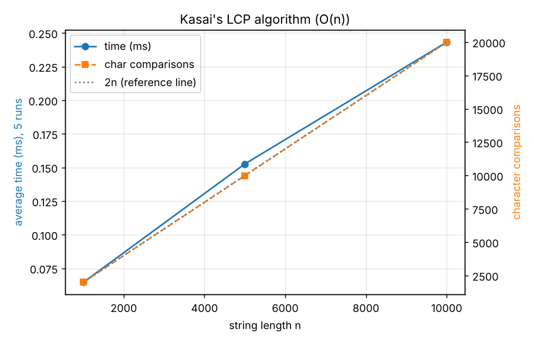

# Assignment 4 — Text Analysis: Dynamic Programming and String Algorithms

**Student:** Zhalynuly Zhassyn, SE-2527

In this assignment I implemented 6 text algorithms in Java, tested them and measured how fast they work.

| Part | Algorithms |
|---|---|
| A. Dynamic Programming | LCS, Edit Distance |
| B. String Matching | Naive, KMP, Rabin–Karp |
| C. Advanced | Kasai's algorithm (LCP array) |

---

## How to run my project

**Java 17+**

```bash
# compile
javac -d out $(find src test -name "*.java")

# run tests
java -cp out tests.AllTests

# run experiments (creates results/*.csv)
java -cp out benchmark.Benchmark

# (optional) draw plots, needs Python + matplotlib
python plots/make_plots.py
```

On Windows PowerShell, compile with:
`javac -d out (Get-ChildItem -Recurse -Filter *.java src,test | ForEach-Object FullName)`

In IntelliJ IDEA you can also open the folder, mark `src` and `test` as source folders and press ▶.

## Project structure

```
src/dp/              LCS.java, EditDistance.java
src/stringmatching/  NaiveMatcher.java, KMPMatcher.java, RabinKarpMatcher.java, StringMatcher.java
src/suffix/          KasaiLCP.java, SuffixArray.java
src/benchmark/       Benchmark.java, RandomStrings.java
test/tests/          AllTests.java
results/             CSV files with my results
plots/               PNG plots + make_plots.py
```

---

## 1. Problem description and algorithms

### LCS (Longest Common Subsequence)

LCS is the longest sequence of characters that appears in both strings in the same order
(the characters do not have to be next to each other).
Example: `"abcde"` and `"ace"` → `"ace"`, length **3**.

I used a DP table where `dp[i][j]` = LCS of the first `i` chars of `a` and the first `j` chars of `b`.

```
dp[0][j] = dp[i][0] = 0
if a[i-1] == b[j-1]:  dp[i][j] = dp[i-1][j-1] + 1
else:                 dp[i][j] = max(dp[i-1][j], dp[i][j-1])
answer = dp[n][m]
```

**Why it works:** if the last characters are equal, I take them and add 1.
If they are different, at least one of them is not in the LCS, so I drop one of them
and take the better result. The smaller answers are already in the table.

### Edit Distance (Levenshtein)

Edit distance is the minimum number of insertions, deletions and substitutions
needed to turn one string into another.
Example: `"kitten"` → `"sitting"` = **3**.

```
dp[i][0] = i,  dp[0][j] = j
cost = (a[i-1] == b[j-1]) ? 0 : 1
dp[i][j] = min( dp[i-1][j] + 1,       // delete
                dp[i][j-1] + 1,       // insert
                dp[i-1][j-1] + cost ) // substitute
answer = dp[n][m]
```

**Why it works:** the last step of the best solution is always one of three things:
delete, insert or substitute. I try all three and take the smallest one.

### Naive string matching

I put the pattern at every position of the text and compare it character by character.
It is simple, but slow on bad inputs.

### KMP (Knuth–Morris–Pratt)

First KMP builds an **LPS table**: `lps[i]` = length of the longest prefix of the pattern
that is also a suffix of `pattern[0..i]`. Example from the lecture:

| char | A | A | A | C | A | A | A | A |
|---|---|---|---|---|---|---|---|---|
| lps  | 0 | 1 | 2 | 0 | 1 | 2 | 3 | 3 |

**How KMP avoids repeated comparisons:** when a mismatch happens, Naive goes back in the text
and checks the same characters again. KMP **never goes back in the text**. It uses the LPS
table to know how many characters already match and continues from there.

### Rabin–Karp

Here I turn the pattern and each text window into a number (hash) and compare numbers instead of strings.
The next window's hash is computed from the previous one in O(1) (**rolling hash**):

```
newHash = ((oldHash - T[i] * B^(m-1)) * B + T[i+m]) mod M     (B = 256, M = 1 000 000 007)
```

**How I handle collisions:** two different strings can have the same hash.
So when the hashes are equal, I **check the characters one by one**. Only a real match is added to the answer.

### Kasai's algorithm (LCP array)

* **Suffix array** = start positions of all suffixes, sorted alphabetically.
* **LCP array** = `lcp[i]` is the length of the common beginning of suffix `sa[i-1]` and suffix `sa[i]`.
  It shows how much neighbouring sorted suffixes repeat each other
  (for example, `max(lcp)` = length of the longest repeated substring).

**Kasai's idea:** if one suffix has `k` common characters with its neighbour, the next suffix
has at least `k - 1`. So I don't start comparing from zero every time, and the algorithm works in O(n).

**I checked `"banana"` by hand:**

| sa[i] | suffix | common with previous | lcp |
|---|---|---|---|
| 5 | a      | –   | 0 |
| 3 | ana    | a   | 1 |
| 1 | anana  | ana | 3 |
| 0 | banana | –   | 0 |
| 4 | na     | –   | 0 |
| 2 | nana   | na  | 2 |

`SA = [5, 3, 1, 0, 4, 2]`, `LCP = [0, 1, 3, 0, 0, 2]` ✔ — my program gives the same result.

---

## 2. Implementation decisions and assumptions

* I wrote all algorithms myself, without library search functions (`indexOf`, regex, etc.).
* I did not use external libraries, so the project compiles with plain `javac`.
* LCS and Edit Distance store the full DP table.
* My string matching returns **all** start indices (0-based), including overlapping ones (`"AA"` in `"AAA"` → `[0, 1]`).
* **Empty pattern → empty list.** I decided that an empty pattern means "nothing to search".
  If the pattern is longer than the text, the result is also an empty list.
* Kasai gets a ready suffix array. I build it with a simple sort (`SuffixArray.java`), and I do **not** time this part.
* Operation counts: for DP I count filled cells; for matching and Kasai I count character comparisons.

---

## 3. Complexity analysis

`n`, `m` — lengths of the two strings (or of the text and the pattern).

| Algorithm | Main operation | Best time | Worst time | Extra space | Why |
|---|---|---|---|---|---|
| LCS | `dp[i][j]` from 3 neighbours | O(n·m) | O(n·m) | O(n·m) | every cell of the table is filled once |
| Edit Distance | min of delete / insert / substitute | O(n·m) | O(n·m) | O(n·m) | same table size |
| Naive | compare pattern at every position | O(n) | O(n·m) | O(1) | worst case: `AAAA…` and `AA…AT` |
| KMP | LPS table + one pass over text | O(n+m) | O(n+m) | O(m) | text index never goes back |
| Rabin–Karp | rolling hash + check on equal hash | O(n+m) | O(n·m) | O(1) | worst case: almost every window must be checked |
| Kasai | reuse `k-1` from previous suffix | O(n) | O(n) | O(n) | `k` grows at most n times in total |

**Theory vs measured time:** Big-O shows how the time **grows**. Real milliseconds also depend on
the computer, Java JIT, memory, etc. So a better Big-O does not always mean faster on small inputs.

**Rabin–Karp:** usually (expected case) it is O(n+m), because collisions are very rare.
But in the worst case every window has to be checked, and it becomes O(n·m).

---

## 4. Testing

All my tests are in `test/tests/AllTests.java`. Result: **37 passed, 0 failed.**

| Algorithm | What I tested |
|---|---|
| LCS | identical strings, completely different, empty strings, `abcde`/`ace` |
| Edit Distance | identical, one empty, substitution (`cat→cut`), insertion (`cat→cart`), deletion (`cart→cat`), `kitten→sitting` |
| String matching | pattern at beginning / middle / end, multiple occurrences, absent, longer than text, empty pattern, + 200 random tests |
| Kasai | `banana` and `banana$` (checked by hand), `aaaa`, + 100 random strings compared with a slow simple method |

In **every** string matching test I check that Naive, KMP and Rabin–Karp return the **same** list of indices.

---

## 5. Experimental setup

* Alphabet: **`ACGT`**, random strings with a **fixed seed** (42, 43, 44).
* I ran each measurement **5 times** and took the **average**. Timer: `System.nanoTime()`.
* Before measuring I do a warm-up, so Java has time to compile the code.
* Generating strings, building the suffix array, printing and writing files are **not** timed.
* I use the same inputs for algorithms that solve the same task.
* My computer: Intel Xeon 2.1 GHz, 2 cores, Linux, OpenJDK 21.

| Experiment | Sizes |
|---|---|
| LCS, Edit Distance | two strings of length 100, 500, 1000 |
| String matching | text 10 000, 50 000, 100 000; pattern length 20 (present and absent) |
| Extra: worst case | text `AAA…A`, pattern `AAA…AT` (length 50) |
| Kasai | strings of length 1000, 5000, 10 000 |

---

## 6. Results

### LCS and Edit Distance

| n | LCS (ms) | Edit Distance (ms) | Cells filled |
|---:|---:|---:|---:|
| 100  | 0.0365 | 0.0576 | 10 000 |
| 500  | 1.5274 | 1.4467 | 250 000 |
| 1000 | 3.3254 | 6.0275 | 1 000 000 |



### String matching (random text, pattern length 20)

| Case | n | Naive (ms) | KMP (ms) | Rabin–Karp (ms) | Naive comparisons | KMP comparisons | RK comparisons |
|---|---:|---:|---:|---:|---:|---:|---:|
| present | 10 000  | 0.0490 | 0.0553 | 0.1093 | 13 369  | 12 521  | 20 |
| present | 50 000  | 0.3161 | 0.4678 | 0.5483 | 66 729  | 62 513  | 20 |
| present | 100 000 | 0.7306 | 0.8242 | 1.1006 | 133 318 | 125 057 | 20 |
| absent  | 10 000  | 0.0435 | 0.0468 | 0.1102 | 13 333  | 12 360  | 0 |
| absent  | 50 000  | 0.3957 | 0.4441 | 0.5502 | 66 575  | 62 518  | 0 |
| absent  | 100 000 | 0.7036 | 0.8498 | 1.0838 | 133 393 | 124 844 | 0 |



### Worst case for Naive (text `AAA…A`, pattern `AAA…AT`)

I added this extra experiment to show the worst case of Naive.

| n | Naive (ms) | KMP (ms) | Rabin–Karp (ms) | Naive comparisons | KMP comparisons |
|---:|---:|---:|---:|---:|---:|
| 10 000  | 1.2033 | 0.0704 | 0.1088 | 497 550   | 19 951 |
| 50 000  | 5.1057 | 0.2669 | 0.5477 | 2 497 550 | 99 951 |
| 100 000 | 9.1326 | 0.4318 | 1.0659 | 4 997 550 | 199 951 |



### Kasai

| n | Time (ms) | Comparisons |
|---:|---:|---:|
| 1000   | 0.0646 | 1 990 |
| 5000   | 0.1526 | 9 989 |
| 10 000 | 0.2432 | 19 989 |



All raw numbers are in the `results/` folder.

---

## 7. Discussion

* **LCS and Edit Distance** grow like **n²**: 10× longer strings → 100× more cells,
  and in my tests the time also grew about 100×. Edit Distance is a bit slower because each cell
  takes the minimum of 3 values. The n = 500 result is a little noisy because the time is very small.
* **On random text all 3 matching algorithms were linear.** Naive was even the fastest:
  with 4 letters, a mismatch usually happens on the 1st character (≈ 1.33 comparisons per position).
  Rabin–Karp was the slowest because it computes a hash (multiply + mod) at every position.
* **Present vs absent pattern** gave almost the same times — one match adds only ~20 comparisons.
  Rabin–Karp had no collisions in my experiments.
* **In the worst case Naive became O(n·m):** about 50·n comparisons, and it was **21× slower than KMP**.
  KMP stayed at ≈ 2n comparisons, as the theory says.
* **Kasai** made ≈ **2n** comparisons for every size, so it is linear (O(n)).

So my experiments agree with the theory.

---

## 8. Conclusion

| Algorithm | Good | Bad |
|---|---|---|
| LCS / Edit Distance | simple, always exact | O(n·m) time and memory — slow for long strings |
| Naive | very simple, no extra memory, fast on random text | O(n·m) on repetitive text |
| KMP | always O(n+m), never goes back in the text | needs an LPS table, a bit more complex |
| Rabin–Karp | O(1) memory, easy to use for many patterns | hash work at every step, worst case O(n·m) |
| Kasai | builds LCP in O(n) | needs a suffix array first |

**Main trade-off:** in my opinion, Naive is the simplest and fine for normal text, KMP is the safest
(always fast), Rabin–Karp is good for many patterns, and the DP algorithms are exact but use a lot of memory.
